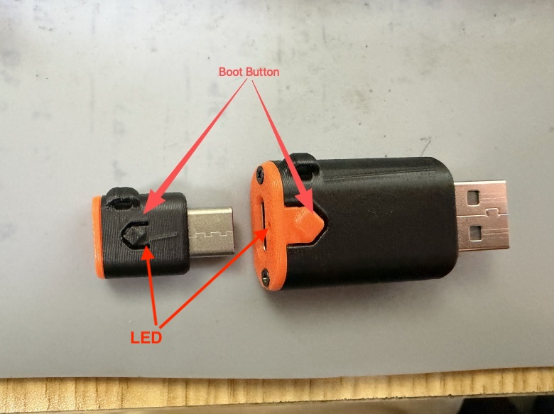
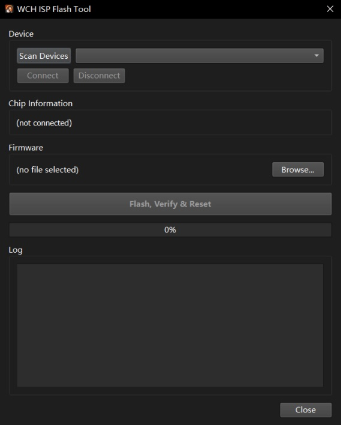
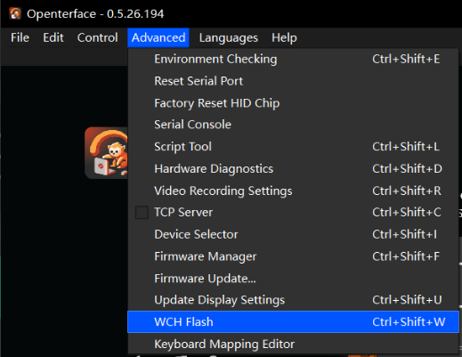
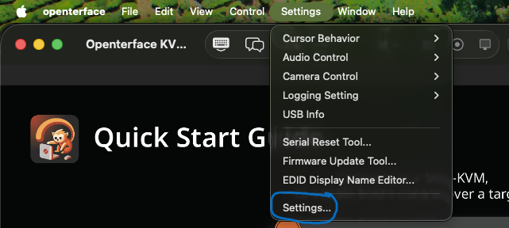
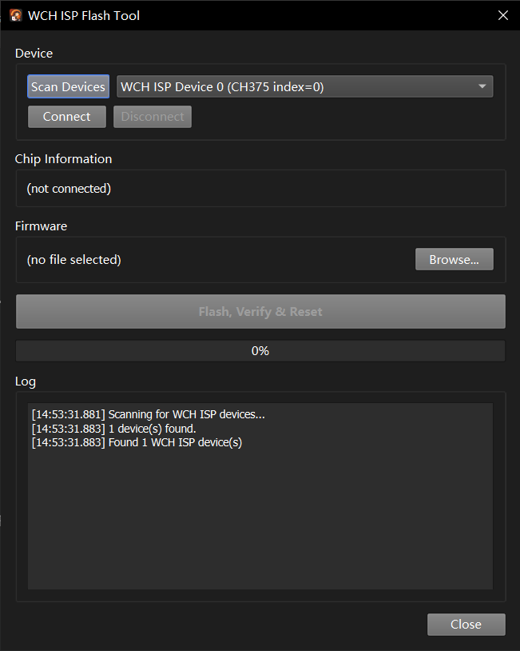
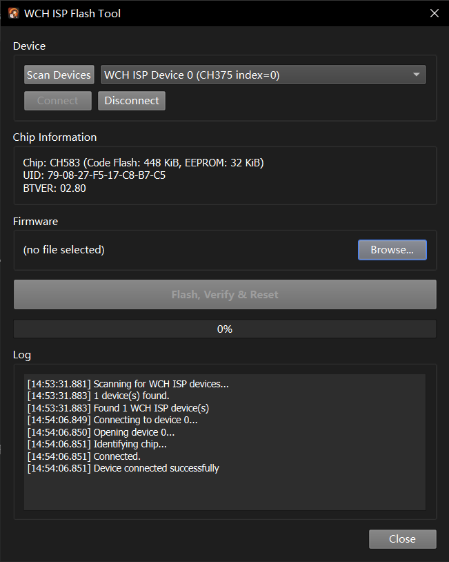
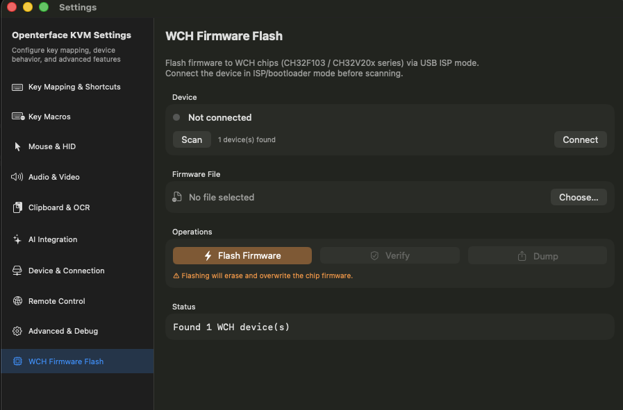
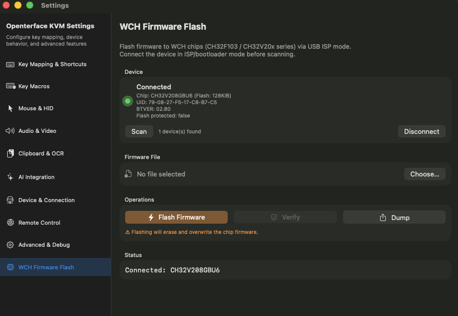
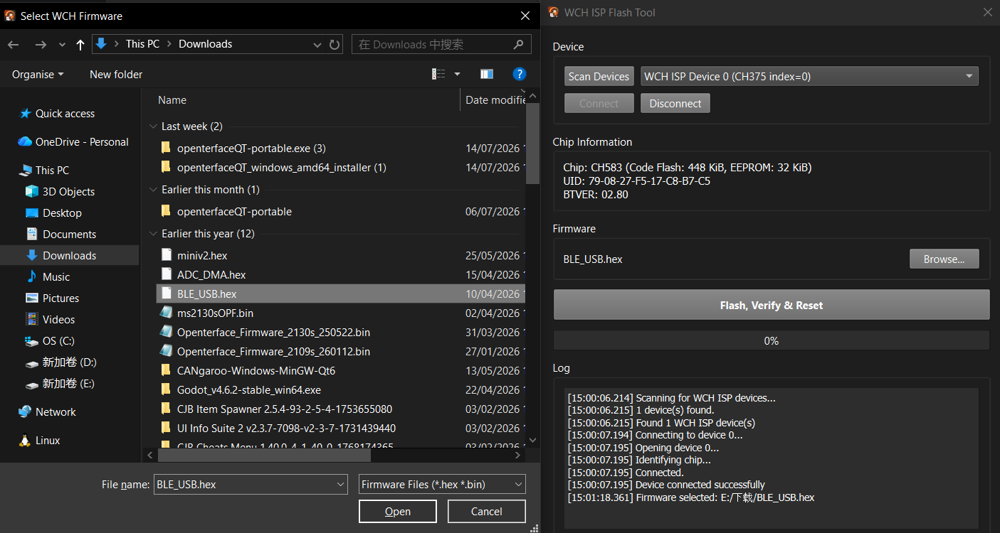
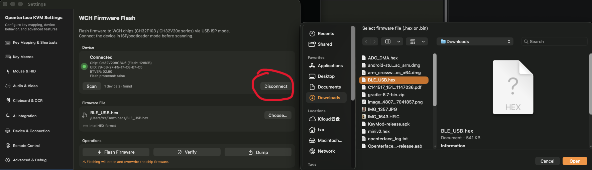

# KeyMod Firmware Update Guide

### Update Your KeyMod Firmware

Updating your KeyMod firmware only takes a few minutes.

Firmware updates may add new features, improve compatibility, fix bugs, or recover a KeyMod that isn't working properly.

This guide explains how to update the **control chip firmware**, which handles keyboard, mouse, and HID functions.

> **Note**
>
> This guide is **only** valid for **KeyMod**. It does **not** apply to Mini-KVM or KVM-Go, which have different hardware and firmware update procedures.

---

# Before You Start

You'll need:

* Your KeyMod
* The firmware file (.bin or .hex)
* Openterface QT (Windows/Linux) or Openterface KVM

**Estimated time:** 2–3 minutes

---

# Install the Flash Tool

Download and install one of the following desktop applications before updating.

All Openterface KVM applications can be found at [openterface.com/kvm](https://openterface.com/kvm/).

| Platform | Application                         |
| -------- | ----------------------------------- |
| Windows  | Openterface KVM (Windows)           |
| Linux    | Openterface KVM (Linux)             |
| macOS    | Openterface KVM (MacOS)                     |

> **Note**
>
> Openterface **KeyCmd** (iOS/Android) is the mobile companion app for KeyMod, but **cannot update firmware**.

---

# Step 1 — Put KeyMod into Update Mode

Before the firmware can be updated, KeyMod must enter **ISP (Update) Mode**.

1. Unplug KeyMod.
2. Press and hold the **BOOT** button.
3. While holding BOOT, plug the KeyMod male connector into the computer.
4. Release the BOOT button.

Your KeyMod is now ready for firmware flashing.

> **How to tell KeyMod is in Update Mode**
>
> When KeyMod is in ISP (Update) Mode, the LED is **off**.
>
> In normal mode, the LED is **solid on** or **flashing**.
>
> If the LED is still on after entering Update Mode, simply repeat the steps above.

> **Tip**
>
> If the flash tool cannot find your device later, simply repeat these steps.

---

# Step 2 — Open the Flash Tool

Launch the appropriate application.

### Openterface KVM (Windows/Linux)

Open:

**Menu → Advanced → WCH ISP Flash**

From the menu, navigate to **Advanced → WCH ISP Flash** to open the flash tool.

### Openterface KVM (MacOS)

Open:

**Settings → Firmware Update Tool...**

This opens the **WCH Firmware Flash** panel where you can scan, connect, choose firmware, and flash.

---

# Step 3 — Connect to Your KeyMod

### Openterface KVM (Windows/Linux)

1. Click **Scan**.
2. Wait for your KeyMod to appear.
3. Select it.
4. Click **Connect**.

After scanning, select your KeyMod from the device list and click **Connect**.

### Openterface KVM (MacOS)

1. In the **WCH Firmware Flash** panel, click **Scan** to detect devices.
2. Wait for your KeyMod to appear in the **Device** section.
3. Click **Connect** to establish a connection.

After connecting, the **Device** section will show your KeyMod's details:

* Chip model (e.g. CH32V208GBU6)
* Bootloader version (e.g. BTVER: 02.80)
* Device UID
* Flash protection status

If no device appears, return to **Step 1** and enter Update Mode again.

---

# Step 4 — Choose the Firmware

### Openterface KVM (Windows/Linux)

Click **Browse**.

Select the firmware file you downloaded.

### Openterface KVM (MacOS)

Click **Choose...** to open the macOS file picker.

Select the firmware file you downloaded.

Supported formats:

* `.bin`
* `.hex`

Both formats work equally well.

---

# Step 5 — Update the Firmware

Click:

**Flash, Verify & Reset**

Confirm the update when prompted.

The application will automatically:

* Parse the firmware
* Erase flash memory
* Program the firmware
* Verify the result
* Restart the device

When finished, you'll see:

> **Firmware flashed and verified successfully. Please reconnect the device.**

> **Important**
>
> Do not disconnect the unplug or close the application while the update is in progress.

---

# Step 6 — Finish

1. Close the flash tool.
2. Unplug KeyMod.
3. Plug it back in normally.
4. Open the application and confirm the firmware version.

Your update is complete.

🎉 Your KeyMod is now running the latest firmware.

---

# Optional Features

## Verify Firmware

You can compare the firmware stored on the device with a firmware file without rewriting it.

1. Enter Update Mode.
2. Scan and connect.
3. Select the firmware file.
4. Click **Verify**.

> **Note**
>
> On Openterface QT, verification happens automatically after flashing.
>
> The standalone **Verify** button is available in Openterface macOS.

---

## Backup Current Firmware

Openterface macOS can save the firmware currently stored on the chip.

1. Enter Update Mode.
2. Scan and connect.
3. Click **Dump**.
4. Save the generated `.bin` file.

This feature is available on **macOS only**.

---

# Troubleshooting

## The device isn't found

Try the following:

* Make sure KeyMod is in Update Mode.
* Use a USB data port, not just power on your PC or laptop
* Try another USB port.
* Close any other applications that may already be using the device.

On macOS, make sure USB permission has been granted.

On Linux, install the required udev rules if you receive a `LIBUSB_ERROR_ACCESS` error.

---

## Flashing fails

* Keep the KeyMod connected.
* Try another USB port.
* Download the firmware again.
* Make sure the firmware matches your KeyMod hardware version.

---

## KeyMod won't start after updating

Don't worry.

The bootloader is protected and can always be entered again.

Simply:

1. Enter Update Mode.
2. Flash the firmware again.

If the problem continues, contact Openterface support.

---

# Frequently Asked Questions

### Do I need to hold the BOOT button every time?

No.

The BOOT button is only used for firmware updates.

---

### Can I permanently damage my KeyMod?

No.

Even if an update fails, the protected ISP bootloader remains available, allowing you to retry the update.

---

### Which firmware file should I use?

Use the firmware provided for your KeyMod hardware version.

Both `.bin` and `.hex` files are supported.

---

### Will updating erase my settings?

No.

Updating the firmware only affects the keyboard and mouse controller firmware.
Other settings are not changed.

---

### Can I update firmware from the KeyCmd mobile app?

No.

Firmware updates require a desktop application:

* Openterface QT
* Openterface macOS

---

# Advanced Information

### USB Device IDs

| Mode            | VID:PID                |
| --------------- | ---------------------- |
| Normal Mode     | 1A86:FE0C              |
| ISP Update Mode | 1A86:55E0 or 4348:55E0 |

---

# Quick Reference

| Item                  | Value                               |
| --------------------- | ----------------------------------- |
| Firmware Format       | .bin or .hex                        |
| Windows/Linux         | Openterface QT                      |
| macOS                 | Openterface QT or Openterface macOS |
| Mobile App            | KeyCmd (No firmware update support) |
| Estimated Update Time | 2–3 minutes                         |

---

## Need Help?

If you experience any problems updating your KeyMod, please visit our Discord community or open a support issue.

We're happy to help!
