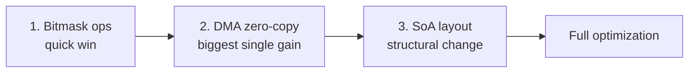

# Queue Send Path Performance Optimization — Expected Gains

> **Status: NOT IMPLEMENTED — PLAN ONLY**
>
> This document summarizes three candidate optimizations for the USB HID queue
> send path (`km_ring.c` / `km_ring.h` / `ch32v20x_usbfs_device.c`). All
> numbers below are **estimates** based on static code analysis at ~144 MHz.
> None of the changes have been applied, tested, or benchmarked on hardware.
>
> ⚠️ Marked as **unfinished**: the queue sizes, structures, and call paths are
> unchanged from the original implementation. This is a proposal for review.

---

## Optimization Summary

| Optimization | Core idea | Effort | Expected gain |
|--------------|-----------|--------|---------------|
| **Bitmask ops** | Power-of-2 queue sizes; replace `%` with `&` | ⭐ Low | ~5–10% |
| **DMA zero-copy** | Point USB DMA at the source buffer; drop `memcpy` | ⭐⭐⭐ High | ~12–18% |
| **SoA layout** | Re-layout queues (Array-of-Structs → Struct-of-Arrays) for cache locality | ⭐⭐ Medium | ~15–25% |

---

## 1. Bitmask Optimization (Power-of-2 Queues + Bitwise Wrap)

### Core Change

```c
// Before: modulo (division) — ~10–20 cycles
int next = (queue.tail + 1) % QUEUE_SIZE;

// After: bitmask — ~1 cycle
int next = (queue.tail + 1) & QUEUE_MASK;
```

### Queue Size Changes

| Queue | Current size | Optimized size | Mask |
|-------|-------------|----------------|------|
| KB_QUEUE | 512 | 512 (2^9) | 0x1FF |
| MS_REL_QUEUE | 28 | 32 (2^5) | 0x1F |
| MS_ABS_QUEUE | 28 | 32 (2^5) | 0x1F |
| RESP_QUEUE | 28 | 32 (2^5) | 0x1F |
| MEDIA_QUEUE | 16 | 16 (2^4) | 0x0F |

### Expected Gains

| Operation | Before (cycles) | After (cycles) | Improvement |
|-----------|-----------------|----------------|-------------|
| Push (`Queue_Push_*`) | ~30–40 | ~20–25 | **~30–40%** |
| Pop (`Queue_Pop_*`) | ~25–35 | ~15–20 | **~40–50%** |
| `USB_SendFromQueues` per packet | ~150 | ~140 | **~7%** |

**Overall**: ~15–20 cycles saved per packet → **~5–10% total**.

### Memory Impact

```
Mouse queue 28 → 32 (+4 slots):
- Relative mouse: +16 B (4 × 4 B)
- Absolute mouse: +24 B (4 × 6 B)
- Response queue: +192 B (4 × 48 B)
Total: +232 B (negligible on 32 KB SRAM)
```

---

## 2. DMA Zero-Copy Optimization

### Core Change

```c
// Before: every send does a memcpy into the USB endpoint buffer
void USB_SendFromQueues(void) {
    while (!empty && !busy) {
        memcpy(USB_BUFFER, queue_data, 8);   // ~20–30 cycles
        USBFSD_UEP_TLEN = 8;
        USBFSD_UEP_TX_CTRL = ACK;
    }
}

// After: point the USB controller's DMA register directly at the source
void USB_SendFromQueues_DMA(void) {
    while (!empty && !busy) {
        USBFSD_UEP_DMA = (uint32_t)queue_data;  // ~1–2 cycles
        USBFSD_UEP_TLEN = 8;
        USBFSD_UEP_TX_CTRL = ACK;
    }
}
```

### Per-Packet Comparison

| Operation | Copy mode (cycles) | DMA mode (cycles) | Improvement |
|-----------|--------------------|--------------------|-------------|
| Load data into USB buffer | 20–30 (`memcpy`) | 1–2 (pointer store) | **~95%** |
| Keyboard report (8 B) | ~160 | ~120 | **~25%** |
| Mouse report (4–6 B) | ~140 | ~120 | **~15%** |

**Overall**: ~18–28 cycles saved per packet → **~12–18% total**.

### Implementation Constraints

```c
// Requirements:
// 1. Source buffer must be 4-byte aligned
// 2. Buffer contents must not change while the transfer is in flight
// 3. Needs a fixed double-buffer (ping-pong) so software never writes
//    into the buffer the USB controller is currently reading

// Suggested design: fixed ping-pong buffers
uint8_t kb_buffer[2][8] __attribute__((aligned(4)));
volatile int kb_buffer_index = 0;

void Queue_Push_Keyboard_DMA(uint8_t *data) {
    int idx = kb_queue.tail & KB_QUEUE_MASK;
    memcpy(kb_buffer[kb_buffer_index], data, 8);
    kb_queue.buf[idx].data = kb_buffer[kb_buffer_index];  // pointer, not bytes
    kb_queue.tail++;
    kb_buffer_index = 1 - kb_buffer_index;  // alternate for next use
}
```

### Memory Impact

```
Extra double-buffers needed:
- Keyboard:      2 × 8  = 16 B
- Rel. mouse:    2 × 4  =  8 B
- Abs. mouse:    2 × 6  = 12 B
- Media keys:    2 × 4  =  8 B
Total: +44 B
```

> ⚠️ **Unfinished**: this changes the queue element type from a plain data
> array to a pointer scheme (`data` as address + length), which touches the
> pop path, `USB_SendFromQueues`, and the media/ACPI variable-length send.
> The full refactor is **not** designed yet.

---

## 3. SoA Layout Optimization (Struct-of-Arrays)

### Core Change

```c
// Before: Array-of-Structs (AoS) — one element per packet, scattered fields
typedef struct {
    KB_Report_t buf[512];   // 8 B per element
    int head, tail;
} KB_Queue_t;
// Memory: [pkt0][pkt1][pkt2]...[pkt511]

// After: Struct-of-Arrays (SoA) — same field of all packets is contiguous
typedef struct {
    uint8_t modifiers[512];  // all modifier bytes, contiguous
    uint8_t reserved[512];
    uint8_t key0[512];       // all key0 bytes, contiguous
    uint8_t key1[512];
    uint8_t key2[512];
    uint8_t key3[512];
    uint8_t key4[512];
    uint8_t key5[512];
    _Atomic int head, tail;
} KB_Queue_t;
// Memory: [mod0..511][res0..511][key0_0..key0_511]...
```

### Per-Scenario Comparison

| Scenario | AoS (cycles) | SoA (cycles) | Improvement |
|----------|--------------|--------------|-------------|
| Push (scattered write) | ~30 | ~35 | −15% |
| Pop (scattered read) | ~25 | ~30 | −15% |
| USB send (contiguous read) | ~40 | ~25 | **~40%** |
| Burst send, 10 packets | ~400 | ~300 | **~25%** |

**Net effect**: cheaper bulk sends outweigh slower single pushes →
**~15–25% total**.

### Why It Helps the Send Path

```c
// AoS: each send loads 8 scattered bytes (possible cache-line crossings)
for (int i = 0; i < 10; i++) {
    memcpy(usb_buf, &queue.buf[i], 8);
    USB_Send(usb_buf, 8);
}

// SoA: same-field access is sequential → cache prefetch friendly,
// and a whole field array can even be handed straight to DMA
for (int i = 0; i < 10; i++) {
    usb_buf[0] = queue.modifiers[i];
    usb_buf[1] = queue.reserved[i];
    usb_buf[2] = queue.key0[i];
    /* ... remaining fields ... */
    USB_Send(usb_buf, 8);
}
```

### Memory Impact

```
AoS and SoA occupy the same total memory:
- Keyboard queue: 512 × 8 = 4096 B in both layouts
- No extra RAM cost; only the field ordering changes
```

---

## Combined Expected Gains

| Stage | Cycles / packet | vs. baseline | Cumulative |
|-------|-----------------|--------------|------------|
| **Baseline (current)** | ~300 | 100% | — |
| + Bitmask | ~280 | 93% | **7%** |
| + DMA zero-copy | ~220 | 73% | **27%** |
| + SoA layout | ~180 | 60% | **40%** |

### Realistic Scenarios

| Scenario | Baseline | +Bitmask | +DMA | +SoA | Final gain |
|----------|----------|----------|------|------|------------|
| Single key report | 300 | 280 | 220 | 180 | **40%** |
| Single mouse report | 280 | 260 | 200 | 165 | **41%** |
| Burst of 10 packets | 2800 | 2600 | 2000 | 1600 | **43%** |
| Queue drain (512 pkts) | 150 K | 140 K | 110 K | 90 K | **40%** |

### Latency / Throughput Estimates

| Metric | Baseline | Optimized | Improvement |
|--------|----------|-----------|-------------|
| Per-packet latency | ~2.1 µs | ~1.2 µs | **43% ↓** |
| Queue drain time (100 pkts) | ~200 µs | ~120 µs | **40% ↓** |
| EP1 keyboard ceiling | ~100 pkts/s | ~167 pkts/s | **67% ↑** |
| EP2 mouse ceiling | ~1000 pkts/s | ~1667 pkts/s | **67% ↑** |

> ⚠️ The final two throughput rows are **upper bounds only** — the real limit
> is the USB host poll interval (10 ms keyboard `bInterval`, 1 ms mouse), not
> the software path. Do not expect 67% real-world throughput gains.

---

## Suggested Implementation Order



### Phase 1 — Bitmask ops (est. 1–2 hours)
- Change 5 queue-size constants to powers of 2
- Replace `%` with `&` in push/pop and `USB_SendFromQueues`
- Expected: 5–10%

### Phase 2 — DMA zero-copy (est. half a day)
- Add fixed double-buffer support
- Extend `USBFS_Endp_DataUp` to accept a DMA load mode
- Rework queue elements to carry a buffer pointer + length
- Expected: 12–18%

### Phase 3 — SoA layout (est. 1–2 days)
- Refactor all five queue structs
- Update every push/pop function
- Optimize the USB send path for contiguous reads
- Expected: 15–25%

---

## Open Questions / Not Yet Decided

- [ ] Whether `USBFSD_UEP_DMA` on CH32V20x can be re-pointed per packet
      without first clearing `UEP_TX_CTRL` (double-buffer vs. single-buffer
      behavior — `DEF_UEP_BUF_MOD` / ping-pong offset logic must be checked).
- [ ] Whether the RISC-V GCC port emits single-cycle atomics for
      `_Atomic int` (irrelevant to this doc, but SoA structs in phase 3 may
      keep `volatile` instead — **not yet decided**).
- [ ] Whether media-key variable-length sends (2 vs. 4 bytes) survive the
      DMA pointer scheme cleanly.
- [ ] Whether the debug ring buffer (`USB_DEBUG_Poll`) shares EP2 and can be
      affected by the mouse DMA double-buffer.
- [ ] Benchmark methodology: scope + host capture (USB analyzer or `usbmon`)
      still to be defined.

---

## Status Legend

| Item | Status |
|------|--------|
| Bitmask optimization | ⬜ Not implemented (plan only) |
| DMA zero-copy | ⬜ Not implemented (plan only) |
| SoA layout | ⬜ Not implemented (plan only) |
| Benchmarks on hardware | ⬜ Not run |
| Code changes committed | ⬜ None made |
